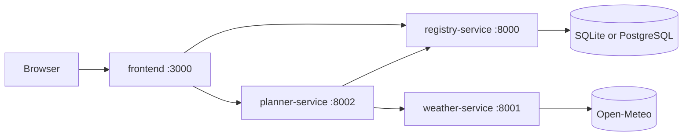

# AgroPilot

AgroPilot helps growers manage crops with data. For every plot it answers one question:

> Should I water this plot today, and for how many minutes?

It combines what is known about a plot (crop, soil, drip layout, location) with the weather forecast and the FAO-56 method for crop water needs, and turns them into a 7-day irrigation plan.

## How it works



The frontend lists farms and plots from the registry and asks the planner for the plan of one plot. The planner reads the plot, its soil and its emitter from the registry and the forecast from the weather service, then calculates the plan. Services talk over HTTP only and never import each other's code. The browser never calls a service directly.

## Services

| Service | Port | What it does | Stack | Docs |
| --- | --- | --- | --- | --- |
| [registry-service](services/registry-service) | 8000 | System of record: farms, plots, and read-only catalogues of crops, soils and emitters | FastAPI, SQLite or PostgreSQL | [README](services/registry-service/README.md) |
| [weather-service](services/weather-service) | 8001 | Daily ET0 and rain forecast from Open-Meteo, cached in memory, with retries and stale answers | FastAPI, httpx | [README](services/weather-service/README.md) |
| [planner-service](services/planner-service) | 8002 | The irrigation plan for a plot: crop coefficient, soil bucket, litres and run minutes | FastAPI, FAO-56 engine | [README](services/planner-service/README.md) |
| [frontend](services/frontend) | 3000 | Farms, plots, today's recommendation and the 7-day plan | Next.js, TypeScript, Tailwind, shadcn/ui | [README](services/frontend/README.md) |

Each README covers that service's API, settings, tests and design decisions. Each service folder also has an `OVERVIEW.md`: a shorter tour of its responsibilities, code layout and known limits.

## Quick start

Requirements: Python 3.12 with [uv](https://docs.astral.sh/uv/), Node.js (LTS), `curl`, and the `sqlite3` CLI. The weather service calls Open-Meteo, so it needs internet access. Docker is needed only to run the registry tests against PostgreSQL.

```bash
cd services/registry-service && uv sync && bash seed_registry.sh && cd ../..   # first time only: builds registry.db (replaces an existing one)
bash scripts/run-all.sh
```

Open http://localhost:3000. `scripts/run-all.sh` starts all four services, wires them to each other and prefixes every log line with the service name. Ctrl-C stops everything. It creates any missing `.env` from `.env.example` (the frontend uses `.env.local`) and refuses to start if a port is taken. Change ports with `REGISTRY_PORT`, `WEATHER_PORT`, `PLANNER_PORT` and `FRONTEND_PORT`.

To run one service on its own, follow the "Run" section of its README.

## Configuration

Everything that changes between a laptop and production lives in the service's own `.env` file, never in code: database URL, the addresses of other services, timeouts, retries, freshness times, API keys.

- Every service has a committed `.env.example` that lists all its variables. `.env` and `.env.local` are never committed.
- A Python service that is missing a required variable stops at startup with an error naming it.
- `.claude/settings.json` blocks coding agents from reading `.env` files. This guards against accidents. It is not a security boundary.

## Errors

Every service answers errors as [RFC 9457](https://www.rfc-editor.org/rfc/rfc9457) `application/problem+json` with a stable `code`:

| Status | `code` | Used by |
| --- | --- | --- |
| 422 | `VALIDATION` | all services |
| 404 | `NOT_FOUND` | registry and planner (unknown resource), all services (unknown route) |
| 409 | `CONFLICT` | registry |
| 503 | `UNAVAILABLE` | registry (database), weather (no forecast to serve) |
| 503 | `UPSTREAM_UNAVAILABLE` | planner (registry or weather is down; `detail` names which) |
| 500 | `INTERNAL` | planner, weather. Registry uses `UNAVAILABLE` for 500 |

## Tests

| Service | Command | Notes |
| --- | --- | --- |
| registry-service | `uv run pytest` | 181 pass on SQLite, 12 PostgreSQL-only tests skipped. Run against PostgreSQL with `TEST_DATABASE_URL` |
| weather-service | `uv run pytest` | 102 tests. Fake provider and fake clock, no network |
| planner-service | `uv run pytest` | 79 tests, including cases calculated by hand. Both upstream services are faked |
| frontend | `npm run lint && npm run build` | No automated tests |

Run `uv run pytest` from the service folder.

## How the irrigation numbers are calculated

The planner follows the FAO-56 single crop coefficient method. Each day: Kc from the growth curve of the crop, crop water use = Kc x ET0, and a soil bucket (`available_water_mm_per_m` x root depth) that rain fills and the crop drains. When the level would fall below half the bucket, the plan irrigates back to full, and the run time follows from the emitter flow and spacing.

- [FAO-56 research notes](services/planner-service/docs/research/fao56.md): the method, with chapter, table and equation numbers
- [irrigation-calc-reference skill](.claude/skills/irrigation-calc-reference/SKILL.md): the formulas, units, crop parameters and hand-checked cases that the engine follows

Every number in a plan comes from the engine in `services/planner-service`. No AI model computes or adjusts irrigation numbers.

For a plain-language walk through the chain (ET0, Kc, the soil bucket, the trigger rule, litres and run minutes), read [How AgroPilot turns weather into drip minutes](reports/Crop%20water%20science%20explained.md). It also flags where the project's rules differ from FAO or from usual drip practice.

## Repository layout

```
services/
  registry-service/     Farms, plots, catalogues
  weather-service/      Forecast from Open-Meteo, cached
  planner-service/      Irrigation engine and plan API
    docs/research/      FAO-56 research notes
  frontend/             Next.js web app (farm-supply look, seedling favicon)
  */OVERVIEW.md         Short tour of each service
scripts/
  run-all.sh            Starts all four services
docs/
  project-overview.md   Registry: business and technical overview
  superpowers/          Design documents and plans (specs/, plans/)
reports/                Written explanations, e.g. the crop water science report
research_notes/         Source notes behind the reports, with links to FAO-56
.claude/
  skills/               registry-api (API conventions), irrigation-calc-reference
                        (and its evaluation workspace)
  settings.json         Blocks agents from reading .env files
```

## Documentation

- [docs/project-overview.md](docs/project-overview.md): what the registry does and how it is built
- [reports/Crop water science explained.md](reports/Crop%20water%20science%20explained.md): how weather becomes drip minutes, and where the project departs from FAO-56
- [research_notes/](research_notes/Crop%20water%20science%20explained): the sourced notes behind that report
- [weather-service design](docs/superpowers/specs/2026-11-12-weather-service-design.md): goals, anti-goals and decisions for the weather service
- [PostgreSQL support](docs/superpowers/specs/2026-11-11-postgres-support-design.md) and its [plan](docs/superpowers/plans/2026-11-11-postgres-support.md)
