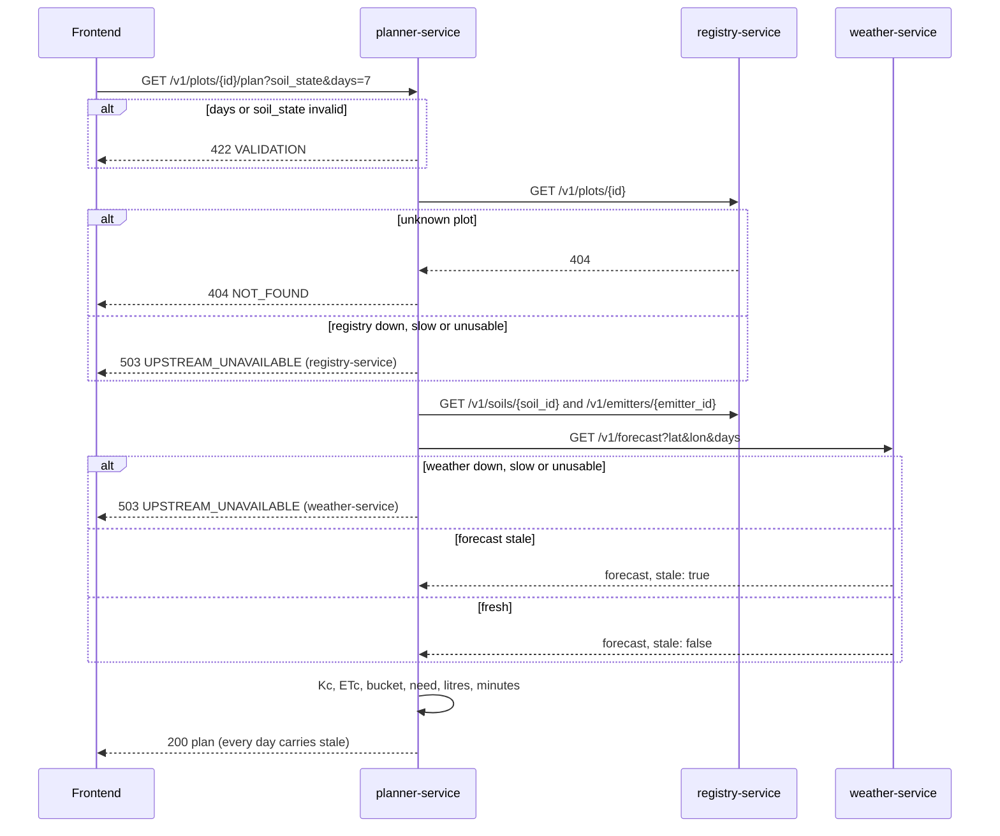

# planner-service

Turns a plot (registry-service) and its weather forecast (weather-service) into a day-by-day irrigation plan. Every number comes from `irrigation.py` and `plan.py`, following the rules in the `irrigation-calc-reference` skill and `docs/research/fao56.md`. No AI model computes or adjusts them.

## Run

```
cp .env.example .env     # set REGISTRY_URL and WEATHER_URL
export $(grep -v '^#' .env | xargs)
uv run uvicorn main:app --port 8002
uv run pytest            # 98 tests, no network: both services are faked
```

A missing `REGISTRY_URL` or `WEATHER_URL` stops startup. `UPSTREAM_TIMEOUT_SECONDS` (default 10) bounds each upstream call.

## API

`GET /v1/plots/{id}/plan?soil_state={dry|half|wet}&days={1..7}` (days default 7), starting today. `soil_state` is required: how wet the soil was the day before (dry starts the bucket at the irrigation trigger, 0.5 × TAW; half at 0.75 × TAW; wet at full). `GET /health` returns `{"status": "ok"}`.

Example (tomato on sand, 1500 m2, 0.6 L/h emitters on 1.5 x 0.4 m, forecast of ET0 5.0 mm and no rain):

```json
{
  "plot_id": "e0b5f3d2-6f40-4c7b-8d44-3f8a5b914004",
  "bucket_capacity_mm": 58.1,
  "trigger_mm": 29.05,
  "days": [
    {"date": "2026-06-01", "et0_mm": 5.0, "kc": 1.15, "need_mm": 0.0,  "litres": 0.0,     "run_minutes": 0.0,    "stale": false, "bucket_end_mm": 52.35},
    {"date": "2026-06-02", "et0_mm": 5.0, "kc": 1.15, "need_mm": 0.0,  "litres": 0.0,     "run_minutes": 0.0,    "stale": false, "bucket_end_mm": 46.6},
    {"date": "2026-06-03", "et0_mm": 5.0, "kc": 1.15, "need_mm": 0.0,  "litres": 0.0,     "run_minutes": 0.0,    "stale": false, "bucket_end_mm": 40.85},
    {"date": "2026-06-04", "et0_mm": 5.0, "kc": 1.15, "need_mm": 0.0,  "litres": 0.0,     "run_minutes": 0.0,    "stale": false, "bucket_end_mm": 35.1},
    {"date": "2026-06-05", "et0_mm": 5.0, "kc": 1.15, "need_mm": 0.0,  "litres": 0.0,     "run_minutes": 0.0,    "stale": false, "bucket_end_mm": 29.35},
    {"date": "2026-06-06", "et0_mm": 5.0, "kc": 1.15, "need_mm": 34.5, "litres": 51750.0, "run_minutes": 2070.0, "stale": false, "bucket_end_mm": 58.1},
    {"date": "2026-06-07", "et0_mm": 5.0, "kc": 1.15, "need_mm": 0.0,  "litres": 0.0,     "run_minutes": 0.0,    "stale": false, "bucket_end_mm": 52.35}
  ]
}
```

| Field | Meaning |
|---|---|
| `bucket_capacity_mm` | size of the soil bucket: `available_water_mm_per_m x root depth` |
| `trigger_mm` | irrigation starts when the level would fall below this (half the bucket) |
| `need_mm` | net irrigation for the day, mm (0 = none) |
| `litres` | `need_mm x area_m2` |
| `run_minutes` | `need_mm / (flow_lph / (row_spacing_m x emitter_spacing_m)) x 60`; 0 on a day without irrigation |
| `bucket_end_mm` | water in the root zone at the end of the day, after rain, ET and irrigation |
| `stale` | the weather forecast behind this day was stale |
| `kc`, `et0_mm` | crop coefficient for that season day and ET0 from weather-service |

Numbers are rounded only here: `kc` to 3 decimals, the rest to 2.

### Errors

All errors are `application/problem+json` with a `code`.

| Status | `code` | When |
|---|---|---|
| 422 | `VALIDATION` | `soil_state` missing or not `dry`/`half`/`wet`, `days` not an integer from 1 to 7, or malformed plot id, or a crop with no parameters |
| 404 | `NOT_FOUND` | unknown plot |
| 503 | `UPSTREAM_UNAVAILABLE` | registry-service or weather-service is down, slow, or sends unusable data. `detail` names the service; `Retry-After` is set. Never a plan of zeros |
| 500 | `INTERNAL` | a bug |

## How the numbers are calculated

Full rules and three FAO-56 cases plus four planner cases (4 to 7) checked by hand: `.claude/skills/irrigation-calc-reference/SKILL.md`. In short, per day: Kc from the growth curve (FAO-56 Eq. 66), ETc = Kc x ET0, a bucket of `available_water_mm_per_m x root depth` that starts at the farmer's `soil_state`, rain added and ETc removed; when the level would fall below half the bucket, irrigate back to full.

## Assumptions to know about

Decisions are in `docs/judgment-log.md` entries 10 to 16.

- **The starting level is the farmer's answer** (`soil_state`, required). The planner has no soil-moisture data of its own.
- **A day runs at most 24 hours.** A refill that needs more is split over days: it continues every day, even above the half-bucket trigger, until the bucket is full. A dry 58 mm sand bucket on 1 mm/h emitters takes three days (24 h, 24 h, then the rest). Rain that fills the bucket ends the refill.
- **Plots past the end of the season** (all four seed plots) hold the crop's end Kc.
- **A stale forecast with fewer days** gives a shorter plan, each day `stale: true`.
- No wind or humidity correction of Kc (the forecast has none), no drip scaling of Kc ini, no runoff.

## Flow


