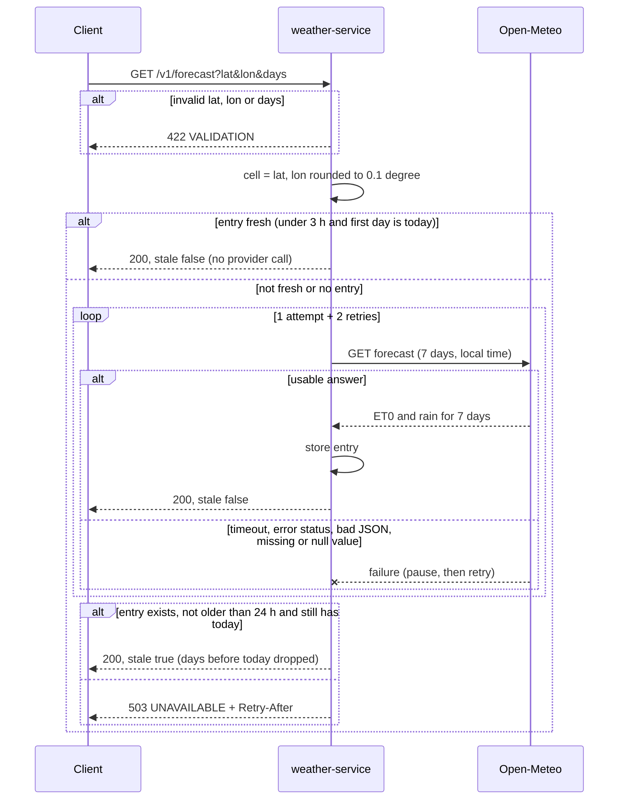

# weather-service

Fetches the daily forecast from Open-Meteo (the provider), keeps it in memory, and serves ET0 and rain to the rest of the system. It knows coordinates and dates only: nothing about farms, plots or crops. Design and decisions: [docs/superpowers/specs/2026-11-12-weather-service-design.md](../../docs/superpowers/specs/2026-11-12-weather-service-design.md).

## Run

```
cp .env.example .env
export $(grep -v '^#' .env | xargs)
uv run uvicorn main:app --port 8001
uv run pytest        # 102 tests, no network: the provider and the clock are faked
```

A missing or invalid variable stops startup and names the variable.

| Variable | Meaning |
|---|---|
| `PROVIDER_BASE_URL` | `https://api.open-meteo.com`. Changing provider or moving to the paid host is a config change |
| `PROVIDER_API_KEY` | May be empty (free tier). When set, sent as the `apikey` query parameter |
| `PROVIDER_TIMEOUT_SECONDS` | Timeout of each attempt |
| `PROVIDER_RETRIES` | Retries after the first failure. `2` means 3 attempts |
| `PROVIDER_RETRY_PAUSE_SECONDS` | Pause between attempts |
| `FRESH_SECONDS` | How long a forecast is fresh (`10800` = 3 h) |
| `MAX_STALE_SECONDS` | Oldest forecast still served as stale (`86400` = 24 h) |

## API

`GET /v1/forecast?lat={lat}&lon={lon}&days={days}`: `lat` -90 to 90, `lon` -180 to 180, `days` 1 to 7. Anything else is `422 VALIDATION`. `GET /health` returns `{"status": "ok"}`.

```json
{
  "lat": 31.25,
  "lon": 34.79,
  "source": "open-meteo",
  "fetched_at": "2026-11-12T06:00:00Z",
  "stale": false,
  "days": [
    {"date": "2026-11-12", "et0_mm": 3.1, "rain_mm": 0.0},
    {"date": "2026-11-13", "et0_mm": 2.8, "rain_mm": 4.2}
  ]
}
```

- `lat` and `lon` echo what the caller sent. `fetched_at` is the UTC time the provider last answered; a stale answer keeps its old value.
- `days` start at today **in the point's local time**. A fresh answer always has exactly `days` entries. **A stale answer can have fewer** (days already in the past are dropped), with no extra field saying so: compare the length with what you asked for.

| Status | `code` | When |
|---|---|---|
| 422 | `VALIDATION` | bad or missing `lat`, `lon`, `days` |
| 503 | `UNAVAILABLE` | the provider failed and there is no forecast we may serve. Has `Retry-After` |
| 500 | `INTERNAL` | a bug |

Errors are `application/problem+json`.

## Open-Meteo variables

Request: `GET {base}/v1/forecast?latitude&longitude&daily=et0_fao_evapotranspiration,rain_sum&timezone=auto&forecast_days=7`. Checked against the live API on 2026-11-15 (`daily_units` in the answer):

| Need | Daily variable | Unit |
|---|---|---|
| ET0 | `et0_fao_evapotranspiration` (FAO-56 Penman-Monteith reference ET) | mm |
| Rain | `rain_sum` (liquid rain only) | mm |

`precipitation_sum` is not used because it includes snow. `timezone=auto` makes the days local to the point, and the answer's `utc_offset_seconds` is stored with the entry so "today" can be computed later without calling the provider. These names appear only in `provider.py`.

## How the cache works

- **Grid cell:** latitude and longitude are rounded to the nearest 0.1° (half rounds away from zero, done in decimal, not with float `round`) and two points in the same cell share one entry. The provider is called with the cell's coordinates. Note 31.25 and 31.24 fall in different cells.
- **Always 7 days:** the provider is asked for 7 days and the entry holds all of them, so a request for 3 days and one for 7 share a cache entry.
- **Fresh:** younger than `FRESH_SECONDS` **and** its first day is still today in the point's time zone. Just after local midnight an entry counts as not fresh and is refetched, so yesterday is never served as today.
- **Provider failure:** a timeout, connection error, non-2xx status, a body that is not JSON, a missing field, a `null` or non-numeric value in any of the 7 days, or an array of the wrong length (or dates that are not consecutive). It is retried (`PROVIDER_RETRIES`), then the last forecast for the cell is served with `stale: true`. With none, `503 UNAVAILABLE`.
- **Never invented numbers:** nothing is ever defaulted, zeroed or filled in. A bad answer is a failure, not data.
- **One call per cold cell:** concurrent requests for the same cell wait for a single provider call.
- **Memory:** the cache is a per-process dictionary. A restart empties it. Entries past the stale limit are removed whenever a new forecast is stored.

## How old a stale forecast may be: 24 hours

`MAX_STALE_SECONDS=86400`. Why:

- A day-long provider outage still gives growers a plan, and the forecast still covers today and most of the week.
- Rain predictions are still useful at that age.
- Longer is risky: a forecast of rain that never came would lead to "no irrigation". Shorter leaves growers with no plan during short outages.
- A stale forecast is also refused when it no longer contains today (an entry fetched at 06:00 is not served after local midnight unless it still has the new day), so it can never describe a past week as the present.

## Performance (NFR-2.3)

`scripts/measure_fresh_latency.py` sends 10 requests per second for 60 seconds at a cached cell, so no request calls the provider. Measured on 2026-11-15 on a laptop (WSL2), client on the same machine, single uvicorn worker:

| Requests | Failures | RPS | Median | **p95** | p99 | Max |
|---|---|---|---|---|---|---|
| 600 | 0 | 10.02 | 6.2 ms | **8.4 ms** | 9.7 ms | 30.2 ms |

That is well under the 100 ms budget. It is a 1-minute run with one cached cell, not the 5-minute run registry-service used.

## Flow


